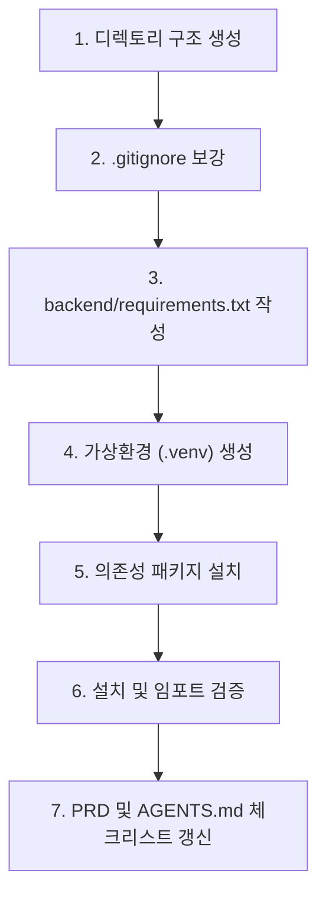

# STEP 1. 환경 준비 구현 계획서

- **상태**: ✅ 완료 (2026-11-14)
- **작성일시**: 2026-11-14
- **관련 문서**: [PRD_업무말투변환기.md](file:///C:/vibecoding/biztalk_antigravity/PRD_업무말투변환기.md), [AGENTS.md](file:///C:/vibecoding/biztalk_antigravity/AGENTS.md)
- **목표**: PRD 8. 단계별 구현 순서 중 **STEP 1. 환경 준비**의 모든 요구사항 구현 및 검증 (완료됨)

---

## 1. 사전 환경 분석 결과

1. **Python 버전**: Python 3.13.13 (요구조건: 3.11+ 충족)
2. **Git 상태**: `origin/main` 브랜치에 연결됨
3. **`.env` 파일**: 프로젝트 루트에 기생성되어 있음 (API 키 보호 지침 준수)
4. **Context7 및 PyPI 최신 패키지 버전 조사**:
   - `fastapi`: 0.162.7
   - `uvicorn`: 0.54.0
   - `langchain`: 1.5.0
   - `langchain-upstage`: 0.7.7
   - `python-dotenv`: 1.2.4
   - `pydantic`: 2.14.3

---

## 2. 작업 순서 및 세부 태스크



### [Task 1] 프로젝트 디렉토리 구조 생성
- `backend/`
  - `routers/`
  - `services/`
  - `prompts/`
  - `models/`
- `frontend/`
  - `css/`
  - `js/`
- `plan/` (본 계획서 보관용)

### [Task 2] `.gitignore` 파일 보강
기존 `.env` 외에 가상환경, 바이트코드, 임시 파일 등을 추가 등록:
```gitignore
.env
.venv/
__pycache__/
*.pyc
.DS_Store
node_modules/
```

### [Task 3] `backend/requirements.txt` 작성
최신 호환 버전 명시:
```text
fastapi>=0.162.0
uvicorn>=0.54.0
langchain>=1.5.0
langchain-upstage>=0.7.7
python-dotenv>=1.2.0
pydantic>=2.14.0
```

### [Task 4] 가상환경(`.venv`) 생성
PowerShell 명령을 통해 프로젝트 로컬 가상환경 구축:
```powershell
python -m venv .venv
```

### [Task 5] 의존성 패키지 설치
가상환경 pip를 통해 패키지 설치:
```powershell
.\.venv\Scripts\pip install -r backend\requirements.txt
```

### [Task 6] 환경 검증
가상환경 Python 인터프리터로 핵심 모듈 임포트 검증:
- `fastapi`, `uvicorn`, `langchain_upstage`, `dotenv`, `pydantic`

### [Task 7] 문서 최신화 (Rule 7 준수)
- [PRD_업무말투변환기.md](file:///C:/vibecoding/biztalk_antigravity/PRD_업무말투변환기.md):
  - `8. 단계별 구현 순서`: `### [x] STEP 1. 환경 준비`로 갱신
  - `2. 완료 체크리스트`: `.env 파일로 API 키를 관리하고, .gitignore에 등록되어 있다` 체크
- [AGENTS.md](file:///C:/vibecoding/biztalk_antigravity/AGENTS.md): 상태 점검 및 최신화 유지

---

## 4. 완료 및 검증 결과

1. **디렉토리 생성 완료**:
   - `backend/routers`, `backend/services`, `backend/prompts`, `backend/models`
   - `frontend/css`, `frontend/js`
   - `plan/`
2. **`.gitignore` 보강 완료**:
   - `.env`, `.venv/`, `__pycache__/`, `*.pyc`, `.DS_Store`, `node_modules/`
3. **`backend/requirements.txt` 작성 완료**:
   - `fastapi>=0.162.0`, `uvicorn>=0.54.0`, `langchain>=1.5.0`, `langchain-upstage>=0.7.7`, `python-dotenv>=1.2.0`, `pydantic>=2.14.0`
4. **가상환경(`.venv`) 구성 및 패키지 설치 완료**:
   - `fastapi-0.162.7`, `uvicorn-0.54.0`, `langchain-1.5.0`, `langchain-upstage-0.7.7`, `pydantic-2.14.3`, `python-dotenv-1.2.4` 등 전체 의존성 설치 완료
5. **임포트 검증 완료**:
   - `All core modules imported successfully!` 확인
6. **문서 동기화 완료**:
   - `PRD_업무말투변환기.md` 체크리스트 및 구현 순서 STEP 1 체크 완료 반영

