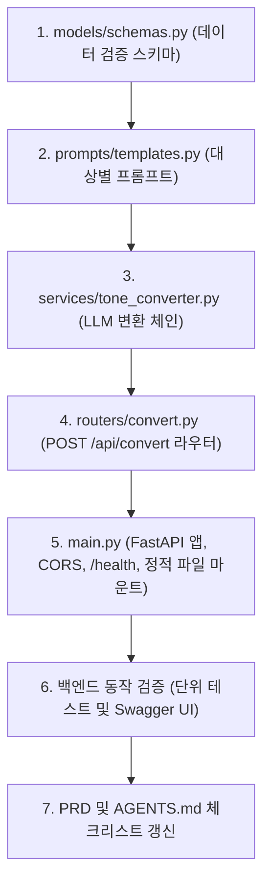

# STEP 2. 백엔드 구현 계획서

- **상태**: ✅ 완료 (2026-11-14)
- **작성일시**: 2026-11-14
- **관련 문서**: [PRD_업무말투변환기.md](file:///C:/vibecoding/biztalk_antigravity/PRD_업무말투변환기.md), [AGENTS.md](file:///C:/vibecoding/biztalk_antigravity/AGENTS.md)
- **목표**: PRD 8. 단계별 구현 순서 중 **STEP 2. 백엔드 구현** 전체 항목 완성 및 검증 (완료)

---

## 1. 사전 조사 결과 (바이브 코딩 원칙 2 적용)

- **Upstage Solar-Pro4 모델 연동 테스트 완료**:
  - `ChatUpstage(model_name='solar-pro4')` 정상 인스턴스화 및 호출 성공 (`Response received: True`)
  - `.env`의 `UPSTAGE_API_KEY`를 `python-dotenv`로 로드하여 원활히 연동됨

---

## 2. 세부 구현 계획 및 파일 구조



### [Task 1] `backend/models/schemas.py`
- Pydantic BaseModel을 활용하여 요청 및 응답 스키마 정의:
  - `ConvertRequest`:
    - `text: str`: 최소 1자 이상 (공백 제외 유효성)
    - `target_audience: Literal["boss", "colleague", "client", "team"]`: 허용된 4종 대상 엄격 검증
  - `ConvertResponse`:
    - `converted_text: str`
    - `target_audience: str`
    - `original_text: str`

### [Task 2] `backend/prompts/templates.py`
- 수신 대상 4종별 명확하고 정교한 비즈니스 톤 프롬프트 정의:
  - `boss`: 상사/임원 대상 격식 있는 경어체, 공손하고 결론 중심
  - `colleague`: 타팀 동료 대상 정중하고 협조적인 업무 요청 어조
  - `client`: 고객/외부 대상 친절하고 신뢰감을 주는 서비스 어조
  - `team`: 팀 내 동료 대상 간결하고 빠른 피드백 위주의 실무적 어조
- 프롬프트 반환 헬퍼 함수 `get_prompt_template(target_audience: str)` 구현

### [Task 3] `backend/services/tone_converter.py`
- `ChatUpstage` 모델 초기화 및 프롬프트 체인 구축:
  - 시스템 프롬프트 + 사용자 입력 텍스트 결합
  - `convert_tone(text: str, target_audience: str) -> str` 비동기/동기 변환 함수
  - Solar-Pro4 호출 중 예외 발생 시 로깅 및 적절한 예외 전파

### [Task 4] `backend/routers/convert.py`
- `APIRouter`를 통한 엔드포인트 분리:
  - `POST /convert` (`/api/convert`로 마운트됨)
  - 입력값 검증 실패 시 422 상태 반환
  - LLM 호출 실패 시 500 에러 (`detail: "LLM API 호출 중 오류가 발생했습니다."`) 반환
  - 성공 시 `ConvertResponse` 반환

### [Task 5] `backend/main.py`
- FastAPI 메인 앱 구성:
  - CORS 미들웨어 등록 (`allow_origins=["*"]`, `allow_methods=["*"]`, `allow_headers=["*"]`)
  - `GET /health` 엔드포인트 (`{"status": "ok"}`)
  - `convert.router`를 `/api` 프리픽스로 등록
  - 정적 파일 마운트 (`frontend/` 폴더를 루트 `/`에 StaticFiles html=True로 마운트하여 정적 웹페이지 라우팅 지원)

---

## 3. 검증 전략 (Verify)

1. **자동화 검증 스크립트 실행**:
   - `GET /health` 응답 검증 (`{"status": "ok"}`)
   - `POST /api/convert` 4가지 대상별 실제 Solar-Pro4 변환 성공 여부
   - 비정상 요청(잘못된 대상 코드, 빈 텍스트) 시 422 에러 반환 검증
2. **로컬 서버 기동 및 Swagger UI 확인**:
   - `uvicorn main:app` 실행 테스트
   - `http://localhost:8000/docs` 문서 정상 노출 검증

---

## 4. PRD 및 AGENTS.md 체크리스트 반영 계획

구현 완료 후 [PRD_업무말투변환기.md](file:///C:/vibecoding/biztalk_antigravity/PRD_업무말투변환기.md)의 다음 항목 체크 완료:
- [x] FastAPI 서버가 로컬에서 정상 실행된다 (`uvicorn main:app`)
- [x] Health Check 기능이 존재해야 한다
- [x] `POST /api/convert` 엔드포인트가 존재한다
- [x] Upstage Solar-Pro4 API 호출이 정상 작동한다
- [x] 수신 대상(4종)에 따라 다른 프롬프트가 적용된다
- [x] CORS 설정이 되어 있어 프론트엔드에서 호출 가능하다
- [x] FastAPI 서버에 Static Page(`index.html`) 라우팅 기능이 있어야 한다
- [x] Swagger UI(/docs)를 통해 API 문서를 브라우저에서 확인할 수 있다
- [x] `STEP 2. 백엔드 구현` 전체 완료 체크

---

## 5. 최종 자동화 검증 결과

```text
=== 백엔드 통합 검증 시작 ===
PASS: GET /health
PASS: GET / (Static Page index.html)
PASS: GET /docs (Swagger UI)
PASS: POST /api/convert (Validation 422 Handling)
PASS: POST /api/convert (boss) -> 성공
PASS: POST /api/convert (colleague) -> 성공
PASS: POST /api/convert (client) -> 성공
PASS: POST /api/convert (team) -> 성공
=== 모든 백엔드 검증 통과 ===
```

