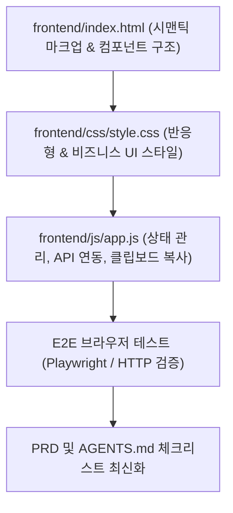

# STEP 3. 프론트엔드 구현 계획서

- **상태**: ✅ 완료 (2026-11-14)
- **작성일시**: 2026-11-14
- **관련 문서**: [PRD_업무말투변환기.md](file:///C:/vibecoding/biztalk_antigravity/PRD_업무말투변환기.md), [AGENTS.md](file:///C:/vibecoding/biztalk_antigravity/AGENTS.md)
- **목표**: PRD 8. 단계별 구현 순서 중 **STEP 3. 프론트엔드 구현** 전체 항목 완성 및 브라우저 검증 (완료)

---

## 1. 프론트엔드 설계 원칙 (`frontend-design` 스킬 반영)

- **디자인 컨셉**: 직장인이 매일 켜두고 쓰는 세련되고 정돈된 비즈니스 생산성 도구 (Professional Business Tool)
- **컬러 팔레트**:
  - 배경: 깔끔한 오프화이트/슬레이트 그레이 (`#f8fafc`, `#f1f5f9`)
  - 카드/컨테이너: 순백색 (`#ffffff`) 및 부드러운 테두리 (`#e2e8f0`)
  - 포인트/액센트: 신뢰감을 주는 비즈니스 블루/네이비 (`#1e40af`, `#2563eb`)
  - 텍스트: 선명한 차콜 그레이 (`#0f172a`, `#334155`)
- **타이포그래피**: 시스템 폰트 스택 (`Pretendard`, `-apple-system`, `BlinkMacSystemFont`, `Segoe UI`, `sans-serif`)을 활용한 선명한 위계와 편안한 행간
- **인터랙션**:
  - 수신 대상 4종 탭: 명확한 활성(Active) 피드백
  - 변환 버튼: 로딩 스피너 및 비활성화(`disabled`) 상태 전환
  - 클립보드 복사: `navigator.clipboard.writeText`를 통한 1클릭 복사 및 "복사 완료!" 토스트 피드백

---

## 2. 파일별 구현 명세

### [Task 1] `frontend/index.html`
- 시맨틱 HTML5 구조 설계:
  - 헤더: 서비스 로고 및 타이틀, 한 줄 설명
  - 컨트롤 섹션: 수신 대상 선택 버튼 4종 (`boss`, `colleague`, `client`, `team`)
  - 워크스페이스 그리드:
    - 좌측/상단: 원문 입력 영역 (`textarea`, 글자 수 안내, 예시 텍스트 넣기 기능)
    - 변환 액션 버튼: 로딩 스피너 포함 [변환하기] 버튼
    - 우측/하단: 변환 결과 영역 (`textarea` 또는 읽기 전용 박스, [복사하기 📋] 버튼)
  - 알림 토스트: 복사 완료 및 안내 메시지용 토스트 엘리먼트

### [Task 2] `frontend/css/style.css`
- 모던하고 군더더기 없는 비즈니스 툴 스타일링:
  - 데스크톱/태블릿/모바일 전 기기 반응형 레이아웃 (Grid & Flexbox)
  - 탭 버튼 활성/호버 인터랙션
  - 로딩 인디케이터 애니메이션
  - 텍스트 입력 영역 포커스 링 및 부드러운 전환 효과

### [Task 3] `frontend/js/app.js`
- 바닐라 자바스크립트(ES6+) 기반 비즈니스 로직:
  - API 엔드포인트: `window.location.origin` 자동 감지 (로컬/배포 환경 무중단 호환)
  - 수신 대상 선택 상태 토글 로직
  - `POST /api/convert` 비동기 `fetch` 호출 및 예외 처리
  - 로딩 상태 관리 (`setLoading(true/false)`)
  - 클립보드 복사 API 연동 (`navigator.clipboard.writeText`) 및 토스트 알림 표시
  - 단축키 지원: `Ctrl + Enter` (또는 `Cmd + Enter`) 입력 시 즉시 변환 실행

---

## 4. 최종 E2E 브라우저 검증 결과

Playwright 브라우저 자동화 도구를 통해 실제 UI 및 비즈니스 로직을 검증 완료했습니다:
1. **정적 리소스 로드**: `index.html`, `style.css`, `app.js` 모두 HTTP 200 정상 반환
2. **수신 대상 탭 토글**: 4종 대상 탭(`boss`, `colleague`, `client`, `team`) 클릭 시 `active` 클래스 및 배지 라벨 정상 갱신 확인
3. **예시 문장 삽입**: `💡 예시 입력` 클릭 시 원문 텍스트 자동 삽입 및 글자수 카운팅 확인
4. **실제 API 변환 연동**: `변환하기` 클릭 시 Upstage Solar-Pro4 호출을 거쳐 결과창에 비즈니스 어조 문장 정상 출력 확인
5. **클립보드 복사 및 피드백**: `복사하기` 클릭 시 클립보드 복사 완료 및 토스트 알림(`📋 클립보드에 복사되었습니다!`) 표시 확인
6. **스크린샷 캡처**: UI 렌더링 확인용 스크린샷 저장 완료 (`biztalk_ui_screenshot-*.png`)

